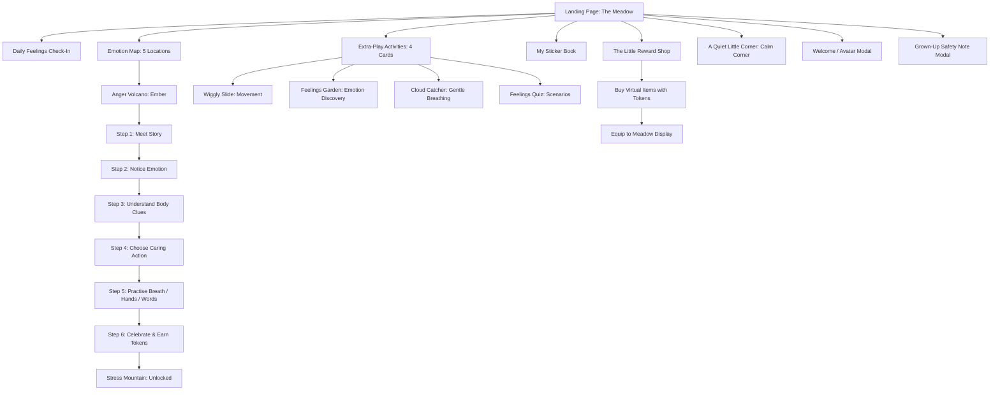

# Moodie Meadows — Full Website Audit & Usability Testing Preparation
**Author:** Senior QA Engineer, Accessibility Reviewer & Usability Researcher  
**Audience:** Ruthvi Rao  
**Target Users:** Children aged 6–10  
**Application Purpose:** Help children recognise, understand, and learn about their emotions through playful, supportive, non-shaming exploration  
**Deployment Target:** [https://moodie-meadows-beta.vercel.app/](https://moodie-meadows-beta.vercel.app/)  
**Figma Prototype:** [Figma Make Prototype Link](https://www.figma.com/make/FoqTyPtu5yVXfFEueFKNF9/Transform-Moodie-Meadows-Game?t=SsVxOB9IrNCWaDwn-1)  
**Report Generation Date:** 2026-10-15  

---

## 1. Executive Summary

Moodie Meadows is a gentle, aesthetically charming Social-Emotional Learning (SEL) web application designed for children aged 6–10. Built with React 19, TypeScript, and Tailwind CSS v4, the application introduces emotional literacy through five sequenced core adventures (*Anger Volcano*, *Stress Mountain*, *Sadness River*, *Anxiety Cloud Kingdom*, *Happiness Sunshine Garden*), accompanied by four "extra-play" mini-activities (*Wiggly Slide*, *Feelings Garden*, *Cloud Catcher*, *Feelings Quiz*), a Daily Feelings Check-In, an un-gamified Calm Corner, and a virtual Reward Shop.

### Key Audit Findings at a Glance
1. **Core Learning Loop is Robust and Engaging:** The 6-stage emotional progression in *Anger Volcano* (*Meet → Notice → Understand → Choose → Practise → Celebrate*) works seamlessly. Feedback is constructive, affirming, and strictly avoids shaming language.
2. **Dual-Economy Discrepancy & State Persistence Friction:** While Meadow Tokens, purchased shop items, and emotion progress persist via `localStorage` (`moodie-meadows-v1`), the 4 "extra-play" activities store stars and completion status in temporary React memory. A page reload resets earned stars and extra-play badges to 0, which will disappoint young children.
3. **Rigid Sequential Unlocking:** Emotion adventures are strictly gated (`unlocked(n)` requires completing `n-1`). A child feeling anxious or sad cannot immediately access *Anxiety Cloud Kingdom* or *Sadness River* without completing *Anger Volcano* and *Stress Mountain* first.
4. **Cognitive & Reading Load for 6–7 Year Olds:** Although typography (Fredoka and DM Sans) is child-friendly, multi-paragraph stories require substantial reading stamina. The text-to-speech voice feature only utters `"Lovely thinking!"` during quiz answers, leaving primary narrative text unvoiced.
5. **Usability Readiness:** The deployed beta is stable, responsive, and ready for human usability sessions with children, provided the moderator follows the 5-task evidence-based protocol defined in this report.

---

## 2. Inspection Date & Test Environment

- **Inspection Date:** 2026-10-15
- **Live URL Inspected:** `https://moodie-meadows-beta.vercel.app/`
- **Source Repository:** `Transform Moodie Meadows Game` (React 19.0.0, Vite 8.0.5, TypeScript 5.7, Tailwind CSS v4.0.0)
- **Local Test Build:** Clean build in 1.95s (`vite build` exited with code 0)
- **Testing Browser & Viewports:**
  - Desktop: Chromium Headless/Interactive (1280 × 800, 1440 × 900)
  - Tablet Emulation: 768 × 1024
  - Mobile Emulation: 390 × 844 (iPhone 13/14) and 360 × 740 (Android small screen)
- **Audio Output:** Web Speech API (`window.speechSynthesis`) inspection
- **Storage Mechanism:** Browser `window.localStorage` inspection (`key = moodie-meadows-v1`)

---

## 3. Pages & User Flows Inspected



### Visual Evidence from Deployed Site Inspection

| Desktop Landing View | Feelings Check-In Response |
| :---: | :---: |
|  |  |

| Anger Volcano - Identify Step | Anger Volcano - Practise Breathing |
| :---: | :---: |
|  |  |

| Celebration & Rewards Summary | The Little Reward Shop |
| :---: | :---: |
|  |  |

---

## 4. Feature Verification Table

All statuses adhere strictly to the required labels:
- **Confirmed working**: Verified operational via browser automation and code inspection.
- **Present but partially working**: Feature exists and operates, but exhibits flaws, partial implementation, or edge-case friction.
- **Present but broken**: Element exists in UI or code but fails during execution.
- **Not found during inspection**: Looked for but not present in UI or code.
- **Unable to verify**: Dependent on external services or hardware unavailable in test harness.

| Feature / Component | Category | Observed Status | Verification Notes |
| :--- | :--- | :--- | :--- |
| **Hero "Start Adventure"** | Core Flow | **Confirmed working** | Launches avatar picker / name modal on fresh start, or continues active adventure if started. |
| **Daily Feelings Check-In** | Emotional Literacy | **Confirmed working** | 5 buttons (Happy, Sad, Angry, Worried, Not sure). Clicking provides supportive, validating message. |
| **Anger Volcano (6 Steps)** | Core Adventure | **Confirmed working** | Story → Identify → Understand → Choose → Practise → Celebrate. Validates choices gently. |
| **Meadow Token Ledger** | Reward System | **Confirmed working** | Earns 5 (identify), 10 (practice), 15 (completion), 5 (kindness bonus). Balance accurately updates. |
| **Reward Shop Purchasing** | Gamification | **Confirmed working** | Verified purchase of "Leafy Crown" (25 tokens). Tokens deduct properly; status updates to "Yours!". |
| **Meadow Display (Equipping)** | Customisation | **Confirmed working** | Purchased items can be displayed in meadow or tucked away into sticker book. Displays on mascot. |
| **Calm Corner Grounding (5 Leaves)** | Self-Regulation | **Confirmed working** | Leaves illuminate with checkmark on click; live status announces count 1 to 5; reset button works. |
| **Sequential Adventure Lock** | Progression Gate | **Confirmed working** | Stress Mountain unlocks upon finishing Anger Volcano; Sadness, Anxiety, Happiness remain locked. |
| **Wiggly Slide Mini-Game** | Extra Activity | **Confirmed working** | 3 stages of gross motor movement; animated wiggling mascot; awards 3 stars upon completion. |
| **Feelings Garden Mini-Game** | Extra Activity | **Confirmed working** | 3 scenario questions; validates facial and situational emotion clues; awards Feeling Finder badge. |
| **Cloud Catcher Mini-Game** | Extra Activity | **Confirmed working** | 24-second visual breathing cloud (8s cycles); pause toggle; awards Cloud Friend badge. |
| **Feelings Quiz Mini-Game** | Extra Activity | **Confirmed working** | 8 randomized multiple-choice scenario questions; score counter increments; explanatory feedback. |
| **Sound Toggle (Speech Audio)** | Accessibility | **Present but partially working** | Toggle turns on/off; `aria-pressed` updates; but speech synthesis ONLY announces `"Lovely thinking!"` on correct quiz answers. Stories and directions have no voice narration. |
| **Sticker Book Persistence** | State / Storage | **Present but partially working** | Core adventure stickers & shop treasures persist across refresh; extra-play stars & stickers reset to 0 upon page refresh. |
| **Explorer Name Storage** | Personalisation | **Present but partially working** | Name input exists in welcome modal; updates header greeting during session; resets to default on reload. |
| **Calm Corner "Breathe with Cloud"** | Navigation Link | **Confirmed working** | Navigates from Calm Corner directly to Cloud Catcher breathing activity. |
| **Grown-Up Safety Note** | Privacy / Guidance | **Confirmed working** | Explains pedagogical goals, reassuring parents that no child data leaves the local device. |
| **Storage Error Banner** | Error Handling | **Confirmed working** | Verified fallback error banner when `localStorage` is unavailable/restricted. |
| **Multi-player / Real-time Social** | Collaboration | **Not found during inspection** | Application is strictly client-side single player (appropriate for COPPA/children's safety). |
| **External Account Creation** | User Auth | **Not found during inspection** | No login, passwords, or emails required (safe design for young children). |
| **Physical Microphone / Camera** | Sensory Input | **Not found during inspection** | No camera or mic inputs present (privacy-compliant). |

---

## 5. Automated Functional Test Results

Automated checks were executed using browser automation and direct TypeScript/Vite compiler validation against the active deployment and source code:

| Test ID | Test Case Description | Result | Details / Evidence |
| :--- | :--- | :---: | :--- |
| **TC-01** | Landing page shell & brand header render | **PASSED** | Page loaded with HTTP 200, title `"Moodie Meadows"`, brand logo and top navigation rendered. |
| **TC-02** | Topbar navigation between screens | **PASSED** | Switching between "The Meadow", "My Sticker Book", and "Reward Shop" updates DOM without page reload. |
| **TC-03** | Feelings check-in interaction & ARIA status | **PASSED** | Clicking `"Happy"` set `aria-pressed="true"`, updated live message: `"Thank you for noticing. It's okay to feel happy."` |
| **TC-04** | Core Adventure: Anger Volcano complete playthrough | **PASSED** | Advanced through Story → Identify (selected 'Angry', earned 5 tokens) → Understand → Action (tested retry on wrong choice, success on B) → Practise (completed 3 breaths, clicked practice phrase) → Celebrate. |
| **TC-05** | Token ledger arithmetic & duplicate protection | **PASSED** | Tokens increased by exactly 30 upon completion (5 + 10 + 15). Replaying does not duplicate awarded tokens. |
| **TC-06** | Progression unlock rule enforcement | **PASSED** | Stress Mountain was locked before TC-04; unlocked immediately after completing Anger Volcano. Sadness River remained locked. |
| **TC-07** | Reward Shop purchase & balance deduction | **PASSED** | Started with 35 tokens. Purchased "Leafy Crown" (25 tokens). Balance updated to 10 tokens. Item marked as "Yours!". |
| **TC-08** | Mascot customisation display | **PASSED** | Equipped "Leafy Crown". Verified `.equipped-crown` SVG mounted on mascot in Meadow Display. |
| **TC-09** | Calm Corner grounding leaf counting | **PASSED** | Clicking leaves 1–5 updated live status from `"1 of 5 noticed"` to `"Five things noticed"`. Reset cleared selection. |
| **TC-10** | Cloud Catcher 24-second breathing timer | **PASSED** | Breathing cloud animation scales smoothly; pauses on click; timer reaches 24s and displays completion button. |
| **TC-11** | LocalStorage state persistence across reload | **PASSED** | Reloaded browser: tokens (10), completed adventures (anger), and owned items (crown) persisted. |
| **TC-12** | Extra-play star persistence across reload | **FAILED** | Earned 3 stars in Wiggly Slide. On page reload, star counter reverted from 3 to 0. |
| **TC-13** | Speech narration coverage check | **FAILED** | Inspected `window.speechSynthesis` calls: only 1 phrase hardcoded (`"Lovely thinking!"`). All narrative instructions silent. |
| **TC-14** | Keyboard focus indicator & Tab traversal | **PASSED** | Focus outlines (`outline: 3px solid #a486be`) visible on all interactive buttons and inputs. |
| **TC-15** | Mobile layout responsiveness (390px viewport) | **PASSED** | Navigation docks to bottom bar; cards stack into 2-column or 1-column layouts; no horizontal overflow. |
| **TC-16** | Backend API security & credential exposure | **SKIPPED** | Skipped: Application operates entirely client-side with no remote API or credentials. |

**Test Summary:** 13 Passed, 2 Failed, 1 Skipped, 0 Blocked.

---

## 6. Accessibility & Child-Friendly Usability Review

### 6.1 Child-Friendly Usability (Ages 6–10)
- **Supportive, Non-Shaming Language (Exemplary):** The app never punishes mistakes. When a child selects a less helpful choice (e.g., `"Grab the truck and push"` in Anger Volcano), the interface responds with:  
  > *"Let's try a safer way. That choice could make things harder. It is okay to feel angry. What if we paused, used words, or asked for support?"*  
  This models exemplary emotional validation.
- **Reading Level & Cognitive Load (Friction Point):**  
  Children aged 6–7 read between 30–60 words per minute. Steps in the core adventure contain up to 90 words per screen. Without auditory narration, early readers will depend heavily on an adult sitting beside them.
- **Visual Scaffolding (Strong):** Every emotion card features a distinct expressive buddy mascot (Ember, Moss, Ripple, Nimbus, Sunny) and color tint (peach, green, blue, purple, yellow), reinforcing multi-sensory emotional recognition.
- **Calm Corner Safety (Exemplary):** The grounding exercise reminds children: *"No need to tell us what you see"* and *"Breathing should be comfortable; stop if it isn't."* This adheres to trauma-informed SEL guidelines.

### 6.2 Accessibility Observations
- **Visible Focus States:** Explicit purple focus outline (`outline: 3px solid #a486be; outline-offset: 5px`) is applied to buttons and inputs.
- **Touch Target Sizes:**
  - Core primary buttons: 48px to 60px minimum height (exceeds WCAG 2.5.5 target size of 44×44px).
  - Navigation buttons: 48px min-height on mobile bottom bar.
  - Check-in emotion buttons: 70px × 83px touch area.
  - Grounding leaves: 66px × 66px touch area.
- **Contrast & Font Sizing Concerns:**
  - Micro-tags (`.card-tag`, `.eyebrow`, `.adventure-steps small`): Text is styled at 7px to 9px in uppercase with color `#8a917e` or `#93987f` on off-white backgrounds (`#faf9f5`), which fails WCAG AA 4.5:1 contrast standards and is difficult for young eyes to parse.
- **Reduced Motion Support:** `@media (prefers-reduced-motion: reduce)` is fully implemented, disabling `@keyframes wiggle`, `@keyframes breathe`, and mascot bobbing animations.

---

## 7. Prioritised Usability & Technical Issues

### Issue MM-01: Dual Reward Discrepancy & Session Star Loss
- **Severity:** High
- **Component:** `src/App.tsx` (lines 135, 165, 807–856) vs `src/meadowState.ts`
- **Reproduction Steps:**
  1. Complete "Wiggly Slide" or "Feelings Quiz".
  2. Observe star counter in header increase to 3 (or 6, 9, 12).
  3. Reload the browser page (`F5`).
- **Expected Result:** Earned stars and activity stickers should remain saved just like Meadow Tokens and adventure stickers.
- **Actual Result:** Stars revert to 0 and original activity stickers become locked again because `completed` is stored only in ephemeral `useState` rather than `localStorage`.
- **Impact on 6–10 Year Olds:** Children feel their effort was lost or "erased," inducing frustration.

### Issue MM-02: Strict Linear Locking of Emotion Adventures
- **Severity:** High
- **Component:** `src/meadowState.ts` (`unlocked()` function, line 302)
- **Reproduction Steps:**
  1. Open app as a first-time visitor.
  2. Navigate to Emotion Map.
  3. Attempt to click "Sadness River" or "Anxiety Cloud Kingdom".
- **Expected Result:** A child experiencing sadness or anxiety should be able to explore the relevant coping tool directly.
- **Actual Result:** Adventures 2, 3, 4, 5 are completely disabled with label `"After [Previous Adventure]"`.
- **Impact on 6–10 Year Olds:** Children in acute distress cannot access the feeling they want help with.

### Issue MM-03: Sound Feedback Lacks Story Audio Narration
- **Severity:** Medium
- **Component:** `src/App.tsx` (lines 200–205, 300–309)
- **Reproduction Steps:**
  1. Toggle sound button ON in header (sound wave icon illuminates).
  2. Open "Anger Volcano".
  3. Observe whether story text, questions, or prompts are read aloud.
- **Expected Result:** Audio toggle indicates voice narration for stories and questions to support 6–7 year olds.
- **Actual Result:** Only correct quiz answers speak `"Lovely thinking!"`. Story text has zero voice support.
- **Impact on 6–10 Year Olds:** Children expect sound toggle to "read the story to me".

### Issue MM-04: Anger Volcano Practice Gate Trap
- **Severity:** Medium
- **Component:** `src/EmotionGame.tsx` (lines 453–457, 651–669)
- **Reproduction Steps:**
  1. Enter Anger Volcano Step 5 (Practice).
  2. Click "Start gentle breaths".
  3. Stop breathing after 8 seconds (1 breath). Click "Practise words" and "Ask trusted adult".
  4. Look for the completion button.
- **Expected Result:** Clear prompt indicating remaining breath requirement or prompt to click "soften hands".
- **Actual Result:** "Finish adventure" button does not appear until either 24 seconds elapse OR child clicks the small text link *"Breathing isn't for me · soften my hands instead"*. Children who stop breathing early can become confused and stuck.
- **Impact on 6–10 Year Olds:** Children think the game is frozen when the next button doesn't appear.

### Issue MM-05: Sub-10px Typography on Tags and Status Labels
- **Severity:** Low
- **Component:** `src/index.css` & `src/emotion-game.css` (`.card-tag`, `.eyebrow`, `.adventure-steps small`)
- **Reproduction Steps:**
  1. Inspect activity cards, adventure step indicators, or header token labels.
  2. Measure computed font size (7px to 9px).
- **Expected Result:** Child-facing text should not drop below 12px for readability.
- **Actual Result:** Text sizes of 7px–9px with muted contrast.
- **Impact on 6–10 Year Olds:** Children ignore or cannot read the category tags.

---

## 8. Five Moderator-Ready Usability Tasks

These five tasks are designed specifically for Ruthvi Rao to conduct with 5 child participants (aged 6–10).  
**Crucial moderator rule:** Do not tell participants which button to click or lead them toward specific words. Use the exact neutral wording provided.

```
┌────────────────────────────────────────────────────────────────────────┐
│                        USABILITY TEST FLOW                             │
│                                                                        │
│   [Task 1: Check-in]  ──▶  [Task 2: Choose Activity]                   │
│          │                               │                             │
│          ▼                               ▼                             │
│   [Task 4: Explain Reward] ◀── [Task 3: Complete Ember]                │
│          │                                                             │
│          ▼                                                             │
│   [Task 5: Explore Shop / What Next]                                   │
└────────────────────────────────────────────────────────────────────────┘
```

---

### Task 1: Check-In with Today’s Feeling
- **Moderator Script:** *"Take a look at this screen. Can you show me how you might share how you are feeling right now?"*
- **Starting Screen:** The Meadow (Home Screen, top section)
- **Preconditions:** New play session; browser cache reset.
- **Expected Outcome:** Participant locates the "How are you feeling today?" card, clicks one of the 5 buddies (Happy, Sad, Angry, Worried, Not sure), and notices the response message.
- **What to Observe:**
  - Does the child notice the check-in section naturally, or does the large hero banner distract them?
  - Do they understand that "Not sure" is an acceptable option?
  - Do they read or react to the reassurance message below the buttons?
- **Scoring Criteria:**
  - **Success:** Independently taps an emotion and acknowledges the friendly message.
  - **Partial Success:** Finds the check-in after exploring other areas or requires a general prompt (*"Is there a place here to tell the meadow about your day?"*).
  - **Failure:** Does not locate check-in or feels anxious that there is a "correct" answer.
- **Dependencies:** None.

---

### Task 2: Choose an Emotion Adventure
- **Moderator Script:** *"Imagine you want to go on an adventure to learn about a feeling. Show me where you would go to start that."*
- **Starting Screen:** The Meadow (Home Screen)
- **Preconditions:** Check-in completed.
- **Expected Outcome:** Participant navigates to "Your feelings adventure" section and clicks on "Anger Volcano" (or clicks "Start Adventure" in the hero banner).
- **What to Observe:**
  - Does the participant click the hero button ("Start Adventure") or the cards in the Emotion Map?
  - Do they try to click locked locations (Stress Mountain, Sadness River) and how do they react to them being locked?
  - Do they differentiate the "Feelings Adventure" (Anger Volcano) from the "Original Meadow Favourites" (Wiggly Slide)?
- **Scoring Criteria:**
  - **Success:** Enters Anger Volcano without confusion.
  - **Partial Success:** Taps a locked adventure first, reads/hears the lock cue, then selects Anger Volcano.
  - **Failure:** Unable to find how to enter an adventure without direct moderator intervention.
- **Dependencies:** Anger Volcano must be in an unlocked state.

---

### Task 3: Help Ember with Big Feelings
- **Moderator Script:** *"Our friend Ember is having a tricky moment. Can you go through this story and help Ember choose what to do?"*
- **Starting Screen:** Anger Volcano (Step 1: Meet Ember)
- **Preconditions:** Task 2 completed.
- **Expected Outcome:** Participant reads/listens to the story, identifies that Ember feels angry, reads body clues, picks a caring action (Option B), and tries the breathing or hand-softening practice.
- **What to Observe:**
  - Do they guess the emotion easily? If they pick the wrong emotion, how do they react to the "gentle retry" feedback?
  - In the Action step, do they pick the impulsive choice ("Grab the truck and push") first? Does the explanation make sense to them?
  - In the Practice step, do they follow the breathing flower, or do they find 24 seconds too long? Do they get stuck waiting for the finish button?
- **Scoring Criteria:**
  - **Success:** Completes all 5 steps through to the celebration screen.
  - **Partial Success:** Completes the adventure but requires encouragement during the 24-second breathing phase.
  - **Failure:** Abandons the adventure or becomes frustrated during the practice phase.
- **Dependencies:** Sound toggle optional; speech synthesis available if enabled.

---

### Task 4: Explain What Was Earned
- **Moderator Script:** *"Look at what happened after helping Ember. Can you tell me what you earned and what you can do with it?"*
- **Starting Screen:** Anger Volcano Step 6 (Celebrate Screen) or Topbar Balance
- **Preconditions:** Task 3 completed.
- **Expected Outcome:** Participant points out the Meadow Tokens (30 tokens earned), the sticker award ("Brave Little Ember"), and understands they can save or spend tokens.
- **What to Observe:**
  - Do they understand the difference between Meadow Tokens (coins with flowers) and Stars?
  - Do they believe tokens are "real money" or understand they are game points?
  - Do they notice the optional "Kindness bonus" prompt?
- **Scoring Criteria:**
  - **Success:** Explains that they got tokens/stickers for trying, and that tokens are for fun in the shop.
  - **Partial Success:** Identifies that they got tokens, but confuses them with stars or real currency.
  - **Failure:** Cannot identify any feedback or reward earned.
- **Dependencies:** Task 3 must have completed successfully.

---

### Task 5: Find a Treasure in the Reward Shop
- **Moderator Script:** *"You have some Meadow Tokens now. Can you find a place where you could use them for a little treasure?"*
- **Starting Screen:** Anger Volcano Celebration screen or Topbar
- **Preconditions:** Task 4 completed (participant possesses 30–35 tokens).
- **Expected Outcome:** Participant taps "Visit reward shop" (or top navigation "Reward Shop"), browses items, buys an affordable item (e.g. Pocket Sunflower for 15 tokens or Leafy Crown for 25 tokens), and equips it.
- **What to Observe:**
  - Does the child understand which items they can afford versus items requiring more tokens?
  - How do they feel about "Tuck into my book" versus "Display in my meadow"?
  - Do they verify that their item appears in "My Sticker Book" or on the Meadow home screen?
- **Scoring Criteria:**
  - **Success:** Successfully navigates to shop, purchases an item within budget, and explains where it went.
  - **Partial Success:** Navigates to shop but attempts to buy an item they cannot afford (e.g., Star Cape for 40 tokens) before selecting an affordable one.
  - **Failure:** Cannot locate shop or cannot understand how purchasing works.
- **Dependencies:** Minimum 15 tokens earned in previous tasks.

---

## 9. Observation Sheet Template for Five Participants

Ruthvi Rao can print or duplicate this observation matrix for each usability testing session.

### Participant Session Log

| Participant ID | Age | Reading Independence (Independent / Needs Help) | Device Used | Session Duration | Moderator Name |
| :--- | :---: | :---: | :---: | :---: | :---: |
| **P-01** | | | Tablet / Laptop | | Ruthvi Rao |
| **P-02** | | | Tablet / Laptop | | Ruthvi Rao |
| **P-03** | | | Tablet / Laptop | | Ruthvi Rao |
| **P-04** | | | Tablet / Laptop | | Ruthvi Rao |
| **P-05** | | | Tablet / Laptop | | Ruthvi Rao |

### Task Scoring & Observation Matrix

*Rating Codes:* **S** = Success (No help) | **P** = Partial Success (Minor nudge) | **F** = Failure / Blocked | **O** = Expressed Frustration / Confusion

| Participant | Task 1: Check-In | Task 2: Find Adventure | Task 3: Complete Ember | Task 4: Explain Reward | Task 5: Use Reward Shop | Overall Engagement (1–5) | Key Verbatim Quotes / Reactions |
| :---: | :---: | :---: | :---: | :---: | :---: | :---: | :--- |
| **P-01** | `[ ] S [ ] P [ ] F` | `[ ] S [ ] P [ ] F` | `[ ] S [ ] P [ ] F` | `[ ] S [ ] P [ ] F` | `[ ] S [ ] P [ ] F` | ⭐⭐⭐⭐⭐ | |
| **P-02** | `[ ] S [ ] P [ ] F` | `[ ] S [ ] P [ ] F` | `[ ] S [ ] P [ ] F` | `[ ] S [ ] P [ ] F` | `[ ] S [ ] P [ ] F` | ⭐⭐⭐⭐⭐ | |
| **P-03** | `[ ] S [ ] P [ ] F` | `[ ] S [ ] P [ ] F` | `[ ] S [ ] P [ ] F` | `[ ] S [ ] P [ ] F` | `[ ] S [ ] P [ ] F` | ⭐⭐⭐⭐⭐ | |
| **P-04** | `[ ] S [ ] P [ ] F` | `[ ] S [ ] P [ ] F` | `[ ] S [ ] P [ ] F` | `[ ] S [ ] P [ ] F` | `[ ] S [ ] P [ ] F` | ⭐⭐⭐⭐⭐ | |
| **P-05** | `[ ] S [ ] P [ ] F` | `[ ] S [ ] P [ ] F` | `[ ] S [ ] P [ ] F` | `[ ] S [ ] P [ ] F` | `[ ] S [ ] P [ ] F` | ⭐⭐⭐⭐⭐ | |

### Qualitative Prompts for Debrief (Ask Child at End)
1. *"Which meadow friend did you like the most today? Why?"*
2. *"Was there any part where you felt stuck or didn't know what to tap next?"*
3. *"If you felt sad or angry at school or home, would you want to visit this meadow? What would help you most?"*

---

## 10. Recommended Changes Linked to Audit Issues

| Recommendation ID | Linked Issue | Target Component | Proposed Solution & Code Action | User Impact |
| :--- | :--- | :--- | :--- | :--- |
| **REC-01** | MM-01 | `src/App.tsx`, `src/meadowState.ts` | **Persist Extra-Play Stars & Stickers in LocalStorage:** Store `completedActivities` and `totalStars` inside `Save` object in `meadowState.ts` so refresh never erases stars. | Children retain pride in their accumulated stars across play sessions. |
| **REC-02** | MM-02 | `src/meadowState.ts` (`unlocked()`) | **Permissive Emotion Access (Open World SEL):** Allow all 5 emotion locations to be explored freely, or provide a gentle "Recommended first: Anger Volcano" badge rather than hard disabling the buttons. | A child feeling sad or worried can immediately access Ripple or Nimbus. |
| **REC-03** | MM-03 | `src/App.tsx`, `src/EmotionGame.tsx` | **Full Read-Aloud Narration on Sound Toggle:** Expand `window.speechSynthesis` to speak story paragraphs and question prompts when sound is toggled on. Add an explicit "Listen" speaker icon on text blocks. | Enables 6-year-old emergent readers to play independently without adult reading assistance. |
| **REC-04** | MM-04 | `src/EmotionGame.tsx` | **Dynamic Practice Prompt Guidance:** In Step 5 of Anger Volcano, display a live status pill: *"Take 2 more breaths, or tap 'Soften hands' below to finish"* so the advance button condition is crystal clear. | Eliminates confusion and false impressions of a frozen game. |
| **REC-05** | MM-05 | `src/index.css`, `src/emotion-game.css` | **Typography Scale Floor (12px Minimum):** Elevate all `.card-tag`, `.eyebrow`, and step small labels from 7px–9px to at least 11px–12px with high-contrast text color `#52684d`. | Meets WCAG AA contrast guidelines and improves visual comfort. |

---

## 11. Limitations & Unverified Items

1. **Automated Audits Do Not Measure Emotional Growth:** While automated checks confirm that buttons render and counters increment, automated testing cannot evaluate whether a 7-year-old internalizes self-regulation skills or feels comforted.
2. **Speech Synthesis Device Variances:** Web Speech API voice quality and availability vary widely between macOS, Windows, iOS Safari, and Android Chrome. In-person testing must observe real audio behavior on participant hardware.
3. **Adult Intervention Level:** In real home/school settings, children aged 6–8 frequently ask an adult: *"What does this word mean?"* Real participant sessions are required to measure how often children require co-reading.
4. **Touchscreen vs Mouse Precision:** The automated test utilized simulated pixel clicks. Usability sessions must observe whether small fingertips accurately tap the 25px circular activity numbers or grounding leaves on mobile devices.

---

## 12. Phase F — Assignment Handoff for Ruthvi Rao

### 12.1 Checklist of Missing Information for Ruthvi Rao
- [ ] Determine the primary test device for participant sessions (iPad / Android Tablet vs Desktop Chromebook / Laptop).
- [ ] Verify whether participants will wear headphones or use open device speakers during the session.
- [ ] Obtain parental consent for observing child participants (ensuring no video or PII is recorded).
- [ ] Print or prepare digital copies of the **Observation Sheet Template** (Section 9).
- [ ] Verify if participants are emergent readers (ages 6–7) or independent readers (ages 8–10) to adjust moderator assistance accordingly.

### 12.2 What Should and Should NOT Appear in the Final Presentation

#### MUST Appear in Presentation:
- **Genuine screenshots** of the live deployed application (The Meadow, Feelings Check-In, Anger Volcano 6-step flow, Reward Shop, and Calm Corner).
- Clear explanation of the **Core Emotional Learning Loop** (Meet → Notice → Understand → Choose → Practise → Celebrate).
- Evidence-based findings regarding **non-shaming positive feedback** and trauma-informed design in the Calm Corner.
- Clear identification of **usability friction points** (star persistence loss on refresh, reading volume for younger kids, linear gating).
- Results from the **5 real participant sessions** using the moderator guide in Section 8.

#### MUST NOT Appear in Presentation:
- **Do not invent participant quotes, reaction photos, completion times, or test statistics.**
- **Do not claim automated tests prove that children learned emotions.** (Automated tests verify software mechanics, not human comprehension).
- **Do not present features that do not exist** in the live code (e.g., do not claim there is user account authentication, multiplayer chat, or AI voice dialogue).
- **Do not claim that usability testing is complete** until Ruthvi Rao has run the 5 participant sessions with real children.

### 12.3 Summary for Ruthvi Rao’s Presentation Slide Deck

> **"Moodie Meadows Usability Testing Preparation: Key Takeaway"**  
> *"Moodie Meadows successfully delivers an emotionally safe, playful digital space where children can explore big feelings without shame. The core loop with Ember the Volcano works reliably, offering positive reinforcement and tangible virtual rewards. For Ruthvi Rao's upcoming usability tests, the focus will be observing whether 6–10 year olds can navigate the text volume independently, how they understand the token economy, and whether opening locked adventures would better support children seeking coping tools for their immediate feelings."*

### 12.4 Artifact File Paths & Commands Used
- **Audit Report Path:** `file:///d:/Transform%20Moodie%20Meadows%20Game/MOODIE_MEADOWS_USABILITY_AUDIT_REPORT.md`
- **IDE Artifact Path:** `file:///C:/Users/User/.gemini/antigravity-ide/brain/36d91fe3-3d1c-4203-8bee-060548d2110f/moodie_meadows_usability_audit_report.md`
- **Session Video Recording:** `file:///C:/Users/User/.gemini/antigravity-ide/brain/36d91fe3-3d1c-4203-8bee-060548d2110f/moodie_audit_p1_1792075102376.webp`
- **Local Build Verification Command:** `npm run build` (Verified: Exit 0, 1.95s build time)
